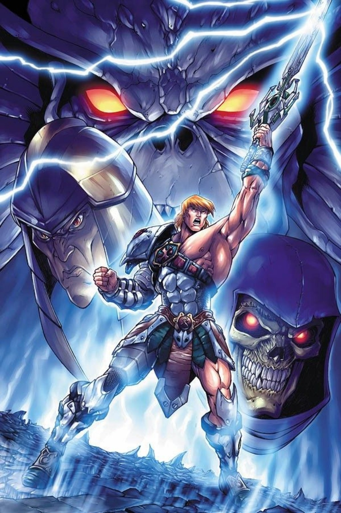

<div align="center">
  
  <h1>#XI — Hyper-Realistic Media Deck</h1>
  <p>Desktop edition · Theme-rich media player · DIY theme studio</p>
</div>

## Desktop app
This repository packages the original Vite/React app as a desktop application with Electron. The supplied artwork is used as the project cover and application icon.

### Build locally
Prerequisites: Node.js 22+ and npm.

```bash
npm install
npm run build
npm run desktop
```

### Create installers

```bash
npm run dist:win     # Windows installer + portable exe
npm run dist:linux   # AppImage + deb
npm run dist:mac     # macOS DMG
```

The installers are written to `release/`. Windows/macOS/Linux builds are also available from the GitHub Actions workflow: push a version tag such as `v1.0.0` or manually run **Build desktop installers** from the Actions tab.

### App artwork
- `assets/cover.jpg` — project cover image
- `assets/icon.png`, `assets/icon.ico`, `assets/icon-512.png` — app icons

### Notes
The app runs locally. Features that use Gemini require your own API key/configuration as in the original project. Do not commit API keys or `.env` files.
